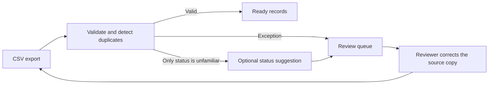

# Ledger Import Review

**Prepare a property ledger for migration and review the exceptions before importing.**

A dependency-free Python CLI that takes a CSV export and produces a JSON import plan. Deterministic rules validate IDs, periods, amounts, and duplicates. An optional local model can suggest how to map unfamiliar status labels. The source file stays intact and the CLI produces a report for a reviewer.

## Run the demo

With Python 3.11 or later, run this from the repository root.

```sh
python ledger_review.py examples/ledger.csv --offline
```

The synthetic sample returns **2 ready records and 5 records to review**. A label of `outstanding` receives a suggestion of `open` and stays in review. An ambiguous label, a malformed amount, and both occurrences of a duplicate ID also stay in review. The offline mode uses a canned suggestion and runs without a model or network access.



## Try local inference

With [Ollama](https://docs.ollama.com/capabilities/structured-outputs) running locally, download a model that supports structured outputs and pass its installed name. Use the synthetic sample for this mode.

```sh
ollama pull gemma4
python ledger_review.py examples/ledger.csv --ollama-model gemma4
```

The CLI sends only the eligible status label to the loopback endpoint. IDs, property codes, periods, and amounts stay out of the request. The response must contain a single allowed status or `unknown`. A model failure leaves the record in review and the plan still includes the other records.

## Review the report

- **Ready** contains validated rows with amounts in integer euro cents.
- **Review** uses one-based CSV record numbers after the header, skipping blank records. A suggestion is advisory. Review the source row, edit a copy of the CSV, then rerun the CLI.
- **Source SHA-256** identifies the exact input file for each report. Keep the report and source together if you need to trace a decision.

The demo assumes one currency, one CSV schema, and an input that fits in memory. It ends at the import plan. The destination write belongs to a separate integration.

## Run the checks

```sh
python -m unittest discover -s tests -v
```

The suite runs offline and checks the Ollama request and response contract with mock HTTP responses.
